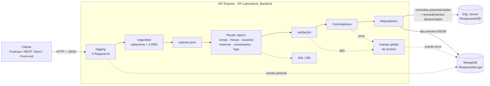
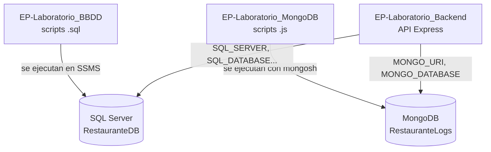

# Restaurante Sazón Criolla · API de Reservas de Mesas

Repositorio **1 de 3**: backend del sistema de reservas del **Restaurante Sazón Criolla**. Es una API REST
construida con **Node.js + Express 5** que gestiona zonas, mesas, clientes y reservas. Usa **SQL Server** para
los datos transaccionales y **MongoDB** para el histórico de actividad (logs) y las reseñas de los clientes.

| Repositorio | Contenido |
| --- | --- |
| **EP-Laboratorio_Backend** (este) | API REST con Node.js + Express |
| [EP-Laboratorio_BBDD](https://github.com/KlausGatjens/EP-Laboratorio_BBDD) | SQL Server: tablas, índices, vistas, procedimientos almacenados y datos |
| [EP-Laboratorio_MongoDB](https://github.com/KlausGatjens/EP-Laboratorio_MongoDB) | MongoDB: esquemas de logs y comentarios y su carga inicial |

> Evaluación Parcial · Desarrollo Web Full Stack Backend · Universidad Autónoma del Perú

---

## Caso de negocio

| | |
| --- | --- |
| **Empresa** | Restaurante Sazón Criolla (cocina peruana, Lima) |
| **Necesidad** | Gestionar mesas, clientes y reservas en tiempo real: que dos clientes no reserven la misma mesa a la misma hora, respetar la capacidad de cada mesa y el horario de atención |
| **Solución** | Express.js para la lógica; SQL Server para la gestión transaccional de usuarios, mesas y reservas; MongoDB para el histórico de logs y las reseñas de los clientes |

| Concepto del enunciado | En este sistema | Recurso REST |
| --- | --- | --- |
| Salas | **Mesas**, agrupadas en **Zonas** (salón, terraza, VIP, barra) | `/mesas`, `/zonas` |
| Usuarios | **Usuarios**: los clientes que reservan | `/usuarios` |
| Reservas | **Reservas** de una mesa para N personas en un horario | `/reservas` |
| Logs y comentarios | **Logs** de actividad y **reseñas** de las visitas | `/logs`, `/comentarios` |

## Contenido

1. [Tecnologías](#tecnologías)
2. [Arquitectura](#arquitectura)
3. [Estructura del proyecto](#estructura-del-proyecto)
4. [Instalación y ejecución](#instalación-y-ejecución)
5. [Variables de entorno](#variables-de-entorno)
6. [Documentación de la API](#documentación-de-la-api)
7. [Reglas del negocio](#reglas-del-negocio)
8. [Persistencia](#persistencia)
9. [Middlewares](#middlewares)
10. [Pruebas](#pruebas)
11. [Cumplimiento de las pautas](#cumplimiento-de-las-pautas)

---

## Tecnologías

| Capa | Tecnología | Uso |
| --- | --- | --- |
| Runtime | Node.js ≥ 20.6 (probado con 22 y 24) | `--env-file` y `--watch` nativos, `node:test` |
| Framework | Express 5 | Un `Router` por recurso, middlewares, errores asíncronos |
| SQL | SQL Server 2019/2022 + driver `mssql` | Zonas, mesas, usuarios y reservas (transaccional) |
| NoSQL | MongoDB 6/7 + driver oficial `mongodb` | Logs del sistema y reseñas (documentos BSON) |
| Documentación | `README.md`, `request.http`, colección de Postman | Contrato de la API y pruebas |

Solo tiene **3 dependencias** (`express`, `mssql`, `mongodb`). La validación, el logging, CORS y las cabeceras
de seguridad están implementados como middlewares propios.

## Arquitectura

Arquitectura en capas: cada petición atraviesa los middlewares globales, llega al router de su recurso, se
valida, el **controlador** aplica la lógica y los **repositorios** (patrón Repository) acceden a la base que
corresponde.



### Cómo se relacionan los 3 repositorios

Los repositorios no comparten código: se conectan **a través de las bases de datos**. Los repositorios 2 y 3
crean la estructura y los datos; la API se conecta a ellas con las variables del archivo `.env`.



Lo que los une son los **nombres**: tablas, vistas, procedimientos almacenados y colecciones. Al iniciar, la API
verifica que existan y, si falta alguno, avisa en consola qué script ejecutar.

### ¿Por qué dos bases de datos?

- **SQL Server** garantiza integridad y consistencia (ACID) donde el negocio lo exige: no puede existir una
  reserva de una mesa o un cliente inexistente, ni dos reservas cruzadas en la misma mesa.
- **MongoDB** guarda información de gran volumen y forma variable (logs, reseñas) sin bloquear las tablas de
  reservas y sin migraciones cuando aparece un nuevo tipo de evento.

## Estructura del proyecto

```text
EP-Laboratorio_Backend/
├── src/
│   ├── config/env.js              # Lectura y validación de variables de entorno
│   ├── db/
│   │   ├── sqlserver.js           # Pool de conexiones a SQL Server
│   │   └── mongodb.js             # Cliente de MongoDB
│   ├── routes/                    # Un Router por recurso + router principal /api/v1
│   │   ├── index.js
│   │   ├── zonas.routes.js
│   │   ├── mesas.routes.js
│   │   ├── usuarios.routes.js
│   │   ├── reservas.routes.js
│   │   ├── comentarios.routes.js
│   │   └── logs.routes.js
│   ├── middlewares/
│   │   ├── logging.js             # Logging de peticiones (consola + MongoDB)
│   │   ├── validacion.js          # Validación declarativa de params, query y body
│   │   ├── seguridad.js           # Cabeceras de seguridad y CORS
│   │   └── manejoErrores.js       # 404, 405 y manejador global de errores
│   ├── controllers/               # Lógica de cada endpoint
│   ├── repositories/              # Acceso a datos (patrón Repository)
│   ├── utils/                     # ErrorHttp, traducción de errores SQL, auditoría
│   ├── app.js                     # Configuración de Express
│   └── index.js                   # Arranque, conexión a las bases y cierre ordenado
├── test/                          # Pruebas automatizadas con node:test
├── postman/
│   └── EP-Laboratorio_Backend.postman_collection.json
├── request.http                   # Pruebas de los endpoints (REST Client de VS Code)
├── .env.example                   # Plantilla de variables de entorno
└── package.json
```

`node_modules/` y `package-lock.json` **no se suben** al repositorio (están en `.gitignore`).

## Instalación y ejecución

### Requisitos

- Node.js 20.6 o superior.
- SQL Server con **autenticación SQL (modo mixto)** y **TCP/IP habilitado**.
- MongoDB local (Compass / `mongod`) o una URI de MongoDB Atlas.
- VS Code con la extensión **REST Client** (para `request.http`) o Postman.

### Pasos

```bash
# 1. Base de datos SQL Server: ejecutar en SSMS los scripts del repositorio EP-Laboratorio_BBDD
#    DDL/01 -> DDL/02 -> DDL/03 -> DDL/04 -> DML/05

# 2. MongoDB: ejecutar los scripts del repositorio EP-Laboratorio_MongoDB
mongosh "mongodb://127.0.0.1:27017" esquemas.js
mongosh "mongodb://127.0.0.1:27017" carga_inicial.js

# 3. API (este repositorio)
git clone https://github.com/KlausGatjens/EP-Laboratorio_Backend.git
cd EP-Laboratorio_Backend
npm install
cp .env.example .env        # PowerShell: Copy-Item .env.example .env
#   editar .env con el usuario y la contraseña de SQL Server
npm run dev
```

La API queda en **`http://localhost:3000/api/v1`** (o en el puerto de la variable `PORT`). Al iniciar:

1. Valida las variables de entorno obligatorias.
2. Se conecta a SQL Server y a MongoDB (si alguna falla, no arranca y muestra el motivo).
3. Verifica que existan las tablas, vistas, procedimientos y colecciones que crean los otros dos repositorios.
4. Registra un evento `sistema` en MongoDB. Con `Ctrl+C` cierra las conexiones de forma ordenada.

### Scripts npm

| Script | Descripción |
| --- | --- |
| `npm run dev` | Inicia en modo desarrollo: se reinicia al guardar cambios (`--watch`) y carga `.env` |
| `npm start` | Inicia el servidor cargando `.env` |
| `npm test` | Ejecuta las pruebas automatizadas (no necesitan las bases de datos) |

### Problemas frecuentes con SQL Server

| Mensaje | Solución |
| --- | --- |
| `Failed to connect to localhost:1433` | Habilitar **TCP/IP** en *SQL Server Configuration Manager* → Protocolos, fijar el puerto 1433 y reiniciar el servicio. O usar `SQL_INSTANCE=SQLEXPRESS` con el servicio *SQL Server Browser* iniciado |
| `Login failed for user 'sa'` | Activar la autenticación **SQL Server y Windows** (modo mixto) y habilitar el usuario `sa` con su contraseña |
| `Faltan objetos: dbo.Mesas...` | Ejecutar los scripts del repositorio EP-Laboratorio_BBDD en orden |

## Variables de entorno

| Variable | Ejemplo | Descripción |
| --- | --- | --- |
| `PORT` | `3000` | Puerto HTTP de la API |
| `NODE_ENV` | `development` | Entorno de ejecución |
| `CORS_ORIGIN` | `*` | Origen permitido por CORS |
| `SQL_SERVER` / `SQL_PORT` | `localhost` / `1433` | Servidor SQL Server |
| `SQL_INSTANCE` | *(vacío)* o `SQLEXPRESS` | Instancia con nombre; si se usa, se ignora `SQL_PORT` |
| `SQL_DATABASE` | `RestauranteDB` | Base creada por EP-Laboratorio_BBDD |
| `SQL_USER` / `SQL_PASSWORD` | `sa` / `***` | **Obligatorias**: usuario SQL |
| `SQL_ENCRYPT` / `SQL_TRUST_CERTIFICATE` | `false` / `true` | Opciones TLS (en Azure: `true` / `false`) |
| `MONGO_URI` | `mongodb://127.0.0.1:27017` | Conexión a MongoDB (local o Atlas) |
| `MONGO_DATABASE` | `RestauranteLogs` | Base creada por EP-Laboratorio_MongoDB |

## Documentación de la API

**URL base:** `http://localhost:3000/api/v1` · **Formato:** JSON (`Content-Type: application/json`)

### Modelo de Madurez de Richardson: nivel 2

| Nivel | Requisito | Cómo se cumple |
| --- | --- | --- |
| 0 | HTTP como transporte | JSON sobre HTTP |
| 1 | Recursos | URIs con sustantivos: `/mesas`, `/usuarios`, `/reservas`; sub-recursos `/mesas/{id}/reservas` |
| 2 | Verbos y códigos HTTP | `GET` lee (seguro e idempotente), `POST` crea, `PUT` reemplaza (idempotente), `DELETE` elimina. Respuestas `200/201/204/400/404/405/409/413/500/503`. `201` incluye la cabecera `Location` y `405` la cabecera `Allow` |

### Endpoints

#### Sistema

| Método | Ruta | Descripción | Éxito |
| --- | --- | --- | --- |
| GET | `/` | Índice con los recursos disponibles | 200 |
| GET | `/salud` | Estado de SQL Server y MongoDB | 200 / 503 |

#### Zonas (SQL Server)

| Método | Ruta | Descripción | Éxito | Errores |
| --- | --- | --- | --- | --- |
| GET | `/zonas` | Listar zonas con su cantidad de mesas | 200 | — |
| POST | `/zonas` | Crear zona | 201 + `Location` | 400, 409 nombre duplicado |
| GET | `/zonas/{id}` | Obtener zona | 200 | 400, 404 |

#### Mesas (SQL Server)

| Método | Ruta | Descripción | Éxito | Errores |
| --- | --- | --- | --- | --- |
| GET | `/mesas?idZona=&capacidadMinima=&activa=` | Listar mesas (filtros opcionales) | 200 | 400 |
| GET | `/mesas/disponibles?fechaInicio=&fechaFin=&personas=` | Mesas libres para N personas en un horario | 200 | 400 |
| POST | `/mesas` | Crear mesa | 201 + `Location` | 400, 404 zona, 409 número duplicado |
| GET | `/mesas/{id}` | Obtener mesa + valoración promedio (MongoDB) | 200 | 400, 404 |
| PUT | `/mesas/{id}` | Reemplazar los datos de la mesa | 200 | 400, 404, 409 |
| DELETE | `/mesas/{id}` | Eliminar mesa | 204 | 404, 409 tiene reservas |
| GET | `/mesas/{id}/reservas` | Reservas de la mesa | 200 | 400, 404 |

#### Usuarios (SQL Server)

| Método | Ruta | Descripción | Éxito | Errores |
| --- | --- | --- | --- | --- |
| GET | `/usuarios` | Listar usuarios | 200 | — |
| POST | `/usuarios` | Crear usuario | 201 + `Location` | 400, 409 correo duplicado |
| GET | `/usuarios/{id}` | Obtener usuario | 200 | 400, 404 |
| PUT | `/usuarios/{id}` | Reemplazar los datos del usuario | 200 | 400, 404, 409 |
| DELETE | `/usuarios/{id}` | Eliminar usuario | 204 | 404, 409 tiene reservas |
| GET | `/usuarios/{id}/reservas` | Reservas del usuario | 200 | 400, 404 |

#### Reservas (SQL Server + procedimientos almacenados)

| Método | Ruta | Descripción | Éxito | Errores |
| --- | --- | --- | --- | --- |
| GET | `/reservas?idMesa=&idUsuario=&desde=&hasta=` | Listar con filtros opcionales | 200 | 400 |
| POST | `/reservas` | Registrar (**`dbo.RegistrarReserva`**) | 201 + `Location` | 400, 404, 409 |
| GET | `/reservas/{id}` | Obtener reserva con mesa, zona y cliente | 200 | 400, 404 |
| PUT | `/reservas/{id}` | Reprogramar (`dbo.ActualizarReserva`) | 200 | 400, 404, 409 |
| DELETE | `/reservas/{id}` | Cancelar (`dbo.CancelarReserva`) | 204 | 404, 409 ya inició |

#### Comentarios / reseñas (MongoDB)

| Método | Ruta | Descripción | Éxito | Errores |
| --- | --- | --- | --- | --- |
| GET | `/comentarios?idMesa=&idUsuario=&calificacionMinima=&buscar=&pagina=&limite=` | Listar reseñas (paginado, búsqueda de texto) | 200 | 400, 503 |
| POST | `/comentarios` | Reseñar una visita terminada | 201 + `Location` | 400, 404 reserva, 409, 503 |
| GET | `/comentarios/resumen` | Promedio general y por aspecto de cada zona (aggregate) | 200 | 503 |
| GET | `/comentarios/{id}` | Obtener reseña | 200 | 400, 404 |
| DELETE | `/comentarios/{id}` | Eliminar reseña | 204 | 400, 404 |

#### Logs (MongoDB)

| Método | Ruta | Descripción | Éxito |
| --- | --- | --- | --- |
| GET | `/logs?tipo=&nivel=&desde=&hasta=&pagina=1&limite=20` | Logs paginados (máx. 100 por página) | 200 |
| GET | `/logs/resumen` | Cantidad por tipo y nivel (aggregate) | 200 |

### Cuerpos de entrada

```jsonc
// POST /zonas
{ "nombre": "Segundo piso", "descripcion": "Salón para eventos" }      // descripcion opcional

// POST /mesas   (PUT exige además "activa")
{ "numero": 106, "capacidad": 4, "idZona": 1, "activa": true }          // numero 1..999, capacidad 1..20

// POST/PUT /usuarios
{ "nombres": "Rosa", "apellidos": "Quispe Mamani",
  "correo": "rosa.quispe@correo.pe", "telefono": "999 888 777" }       // correo único, se guarda en minúsculas

// POST/PUT /reservas   (fechas ISO 8601 CON zona horaria; se guardan en UTC)
{
  "idMesa": 3,
  "idUsuario": 2,
  "fechaInicio": "2026-12-17T20:00:00-05:00",
  "fechaFin": "2026-12-17T22:00:00-05:00",
  "numeroPersonas": 4,
  "observaciones": "Cumpleaños"                                          // opcional
}

// POST /comentarios
{
  "idReserva": 6,
  "calificacion": 4,                                                     // 1..5
  "aspectos": { "comida": 5, "servicio": 4, "ambiente": 4 },             // opcional
  "texto": "Los anticuchos, muy ricos",
  "etiquetas": ["anticuchos", "grupo"]                                   // opcional, máx. 5
}
```

Los campos no declarados se rechazan con `400`, para evitar datos inesperados.

### Respuestas

Creación exitosa (`201 Created`, cabecera `Location: /api/v1/reservas/11`):

```json
{
  "idReserva": 11,
  "idMesa": 3,
  "numeroMesa": 103,
  "zona": "Salón principal",
  "idUsuario": 2,
  "cliente": "Carlos Mendoza Flores",
  "correoCliente": "carlos.mendoza@correo.pe",
  "fechaInicio": "2026-12-18T01:00:00.000Z",
  "fechaFin": "2026-12-18T03:00:00.000Z",
  "numeroPersonas": 4,
  "observaciones": "Cumpleaños",
  "fechaCreacion": "2026-10-18T20:15:00.000Z"
}
```

Todos los errores tienen **la misma forma**, lo que facilita su uso desde un front-end:

```json
{
  "estado": 409,
  "error": "Conflict",
  "mensaje": "La mesa ya está reservada en ese horario",
  "idPeticion": "3f9d6c1e-2b8a-4c55-9f0e-7a1b2c3d4e5f"
}
```

```json
{
  "estado": 400,
  "error": "Bad Request",
  "mensaje": "Los datos enviados no son válidos",
  "detalles": [
    { "campo": "capacidad", "origen": "body", "mensaje": "debe ser un número entero entre 1 y 20" },
    { "campo": "idZona", "origen": "body", "mensaje": "es obligatorio" }
  ],
  "idPeticion": "8a1d2c3b-4e5f-4a6b-9c7d-0e1f2a3b4c5d"
}
```

### Códigos de estado

| Código | Cuándo se usa |
| --- | --- |
| 200 OK | Lectura o actualización exitosa |
| 201 Created | Recurso creado (incluye la cabecera `Location`) |
| 204 No Content | Eliminación o cancelación exitosa / preflight CORS |
| 400 Bad Request | Validación fallida, JSON mal formado, fecha pasada, fuera de horario, duración inválida |
| 404 Not Found | Ruta inexistente o recurso (zona, mesa, usuario, reserva, reseña) no encontrado |
| 405 Method Not Allowed | Verbo no soportado en la ruta (incluye la cabecera `Allow`) |
| 409 Conflict | Dato duplicado, mesa ocupada, capacidad insuficiente, mesa fuera de servicio, borrar con reservas, reseña repetida |
| 413 Payload Too Large | Cuerpo mayor a 100 KB |
| 500 Internal Server Error | Error inesperado (el detalle solo se registra en el log, no se expone) |
| 503 Service Unavailable | SQL Server o MongoDB no disponibles |

## Reglas del negocio

Las reglas de las reservas viven en el **procedimiento almacenado** `dbo.RegistrarReserva` (repositorio
EP-Laboratorio_BBDD). Se ejecuta en una transacción y bloquea la fila de la mesa para evitar que dos peticiones
simultáneas la reserven a la misma hora.

| Regla | Código SQL | HTTP |
| --- | --- | --- |
| Fechas válidas (fin posterior al inicio) | 50001 | 400 |
| No reservar en el pasado | 50002 | 400 |
| Duración de 30 minutos a 4 horas | 50003 | 400 |
| Horario de atención de 12:00 a 23:00 (hora de Lima) | 50004 | 400 |
| La mesa existe | 50005 | 404 |
| La mesa está activa (no en mantenimiento) | 50006 | 409 |
| El usuario existe | 50007 | 404 |
| Personas ≤ capacidad de la mesa | 50008 | 409 |
| La mesa no tiene otra reserva que se cruce | 50009 | 409 |
| El cliente no tiene otra reserva que se cruce | 50010 | 409 |
| La reserva existe (actualizar/cancelar) | 50011 | 404 |
| Solo se modifican o cancelan reservas que aún no empiezan | 50012 | 409 |

La traducción de códigos SQL a HTTP está en [`src/utils/erroresSql.js`](src/utils/erroresSql.js).

Reglas de las reseñas (MongoDB), verificadas por la API consultando SQL Server antes de guardar:

- La reserva debe existir (`404`) y la visita debe haber terminado (`409`).
- Una sola reseña por reserva (`409`), garantizada además por el índice único `ux_reserva`.

## Persistencia

### SQL Server: `RestauranteDB`

Esquema en **3FN** con 4 tablas (`Zonas`, `Mesas`, `Usuarios`, `Reservas`), restricciones con nombre (PK, FK,
UNIQUE, CHECK), índices, 2 vistas y 3 procedimientos almacenados. El detalle está en el README del repositorio
[EP-Laboratorio_BBDD](https://github.com/KlausGatjens/EP-Laboratorio_BBDD).

- Todas las consultas son **parametrizadas** (`request.input(...)`), lo que evita la inyección SQL.
- Las lecturas usan las vistas `vw_MesasDetalle` y `vw_ReservasDetalle` (JOIN sin duplicar datos).
- Las escrituras de reservas pasan **solo** por los procedimientos almacenados.

### MongoDB: `RestauranteLogs`

| Colección | Contenido |
| --- | --- |
| `logs` | Esquema flexible: `{ tipo, nivel, fecha, datos }`, donde `datos` cambia según el tipo (`peticion`, `auditoria`, `error`, `sistema`) |
| `comentarios` | Reseñas con la mesa y el autor **embebidos** (desnormalización intencional) |

El detalle (validadores `$jsonSchema`, índices TTL, únicos y de texto) está en el README del repositorio
[EP-Laboratorio_MongoDB](https://github.com/KlausGatjens/EP-Laboratorio_MongoDB).

- El `idPeticion` (cabecera `X-Request-Id`) permite **correlacionar** la petición, su auditoría y su error.
- Los logs se escriben **después de responder**: un fallo de MongoDB nunca revierte una operación SQL ya confirmada.
- `GET /mesas/{id}` **combina las dos bases**: datos de la mesa (SQL Server) + valoración promedio (MongoDB).

## Middlewares

| Middleware | Archivo | Responsabilidad |
| --- | --- | --- |
| Logging | `src/middlewares/logging.js` | Genera `X-Request-Id`, mide la duración y registra cada petición en consola y en MongoDB |
| Seguridad | `src/middlewares/seguridad.js` | `X-Content-Type-Options`, `X-Frame-Options`, `Referrer-Policy`, CORS y preflight |
| Body parser | `express.json({ limit: '100kb' })` | Convierte el JSON y limita el tamaño del cuerpo |
| Validación | `src/middlewares/validacion.js` | Valida `params`, `query` y `body` con reglas declarativas y acumula todos los errores |
| 404 / 405 | `src/middlewares/manejoErrores.js` | Ruta inexistente y método no permitido (con la cabecera `Allow`) |
| Errores | `src/middlewares/manejoErrores.js` | Manejador global: traduce errores SQL, de MongoDB, de JSON y de dominio a una respuesta uniforme |

Express 5 envía automáticamente al manejador global los errores de los controladores `async`, así que no se
necesitan bloques `try/catch` en cada ruta.

## Pruebas

### Automatizadas

```bash
npm test
```

60 pruebas con el runner nativo `node:test`. No necesitan las bases de datos:

- **`test/api.test.js`**: levanta Express en un puerto aleatorio y verifica las respuestas 400 (validación con
  detalle por campo, JSON mal formado, fechas sin zona horaria), 404, 405 con `Allow`, 503 sin bases, las
  cabeceras de seguridad y el `X-Request-Id`.
- **`test/unidad.test.js`**: traducción de errores SQL a HTTP y reglas de validación.

### De los endpoints (con las bases cargadas)

- **[`request.http`](request.http)**: abrir en VS Code con la extensión REST Client y ejecutar de arriba hacia
  abajo. Cubre los casos de éxito y de error de cada recurso, y al final limpia lo que creó.
- **[Colección de Postman](postman/EP-Laboratorio_Backend.postman_collection.json)**: *Import* en Postman y
  *Run collection*. Cada petición verifica su código de estado esperado.

## Cumplimiento de las pautas

| Requisito | Evidencia |
| --- | --- |
| Configuración de entorno profesional | `.env.example`, `src/config/env.js`, scripts `npm run dev` / `start` / `test`, servidor en la variable `PORT` |
| Router por recurso | `src/routes/`: un `Router` por recurso (zonas, mesas, usuarios, reservas, comentarios, logs) |
| Middleware de logging | `src/middlewares/logging.js` (consola + MongoDB) |
| Middleware de validación | `src/middlewares/validacion.js` |
| Manejo global de errores | `src/middlewares/manejoErrores.js` |
| SQL Server en 3FN + procedimiento para registrar reserva | Repositorio EP-Laboratorio_BBDD (`dbo.RegistrarReserva`) |
| MongoDB con logs en BSON y esquema flexible | Repositorio EP-Laboratorio_MongoDB (colección `logs`) |
| Richardson nivel 2, verbos y códigos correctos | Ver [Documentación de la API](#documentación-de-la-api) |
| Documentación de endpoints | Este README + colección de Postman |
| `request.http` con las pruebas | [`request.http`](request.http) |
| Sin `node_modules` ni `package-lock.json` | `.gitignore` |
| Conexión a MS-SQL y MongoDB | `src/db/sqlserver.js`, `src/db/mongodb.js` |
